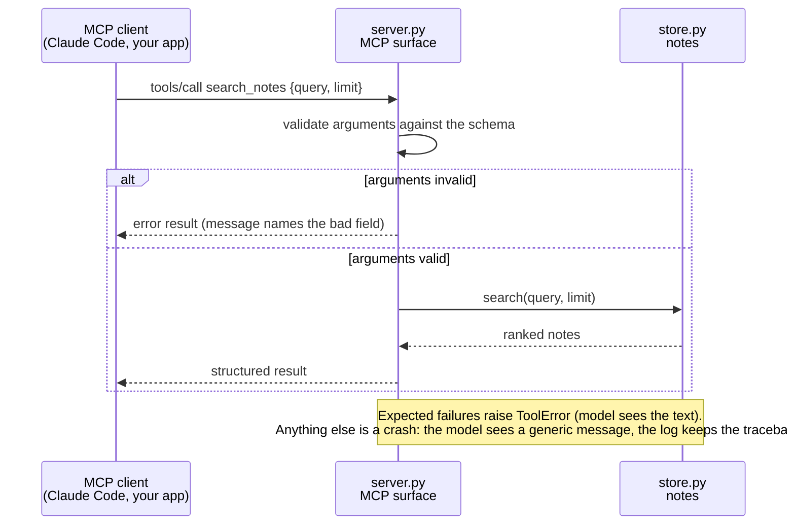

<div align="center">

# notes-mcp

**A small MCP server you can read in ten minutes and copy.**<br>
Typed tools, clean errors, tests that run the server for real. Python.

[](https://github.com/vivek-d-doshi/mcp-server-starter/actions/workflows/ci.yml)


[Try it](#try-it-in-60-seconds) · [What it exposes](#what-it-exposes) · [How a call flows](#how-a-call-flows) · [Use it from Claude Code](#use-it-from-claude-code) · [Design choices](#design-choices) · [Tests](#tests)

</div>

---

## Why this exists

Most MCP examples stop at "hello world". This one shows the parts that decide whether a server is usable in practice:

- **Narrow, typed tools**, so the model sees an exact schema instead of a free-form string.
- **Errors the model can act on** ("use `search_notes` to find ids"), while real crashes stay in your logs.
- **Tests that start the server as a subprocess** over stdio and HTTP, the way a real client does. No LLM, no flakiness.

It searches, reads and adds short notes. The domain is deliberately boring so the protocol code is the only thing to read.

## Try it in 60 seconds

```bash
git clone https://github.com/vivek-d-doshi/mcp-server-starter.git
cd mcp-server-starter
python -m venv .venv && source .venv/bin/activate
pip install -e ".[dev]"

pytest -q                   # 21 tests
python examples/client.py   # starts the server over stdio and calls each tool
```

What the example client prints (real output):

```text
tools: search_notes, get_note, add_note
- n1: Why evals come before prompts
- n5: Staged rollouts for prompt changes

get_note n2 -> MCP tools should be small and typed
unknown id  -> error: Error executing tool get_note: No note with id 'nope'. Use search_notes to find ids.
```

## What it exposes

| Kind | Name | Arguments | Notes |
|---|---|---|---|
| Tool | `search_notes` | `query` (1–200 chars), `limit` (1–20, default 5) | Title and tag matches rank above body matches |
| Tool | `get_note` | `note_id` | Unknown id returns an error that tells the model what to do next |
| Tool | `add_note` | `title` (≤200), `body` (≤10,000), `tags` (≤10) | Persists only if `NOTES_FILE` is set |
| Resource | `notes://{note_id}` | n/a | A note rendered as Markdown |
| Prompt | `summarize_note` | `note_id` | A ready-made "summarize in two sentences" prompt |

<details>
<summary><b>See the exact schema the model receives</b> (click to expand)</summary>

The argument limits live in the Python signature. The SDK turns them into this JSON Schema, and rejects bad input before your code runs.

```json
{
  "type": "object",
  "properties": {
    "query": { "description": "Words to look for", "maxLength": 200, "minLength": 1, "type": "string" },
    "limit": { "default": 5, "description": "Maximum results", "maximum": 20, "minimum": 1, "type": "integer" }
  },
  "required": ["query"]
}
```

</details>

<details>
<summary><b>See real responses</b> (click to expand)</summary>

`search_notes` with `{"query": "mcp tools", "limit": 2}`:

```json
{
  "result": [
    {
      "id": "n2",
      "title": "MCP tools should be small and typed",
      "body": "Prefer several narrow tools with typed arguments over one tool that takes a free-form string. The schema is the contract the model sees.",
      "tags": ["mcp", "tools"]
    }
  ]
}
```

`get_note` with an id that does not exist is an **error result**, not a crash, and the message is written for the model:

```text
Error executing tool get_note: No note with id 'nope'. Use search_notes to find ids.
```

`search_notes` with `{"query": "x", "limit": 999}` is rejected before it runs:

```text
Error executing tool search_notes: 1 validation error for search_notesArguments
limit
  Input should be less than or equal to 20 [type=less_than_equal, input_value=999, input_type=int]
```

Reading the resource `notes://n3`:

```markdown
# RAG: hybrid beats pure vector

Combining keyword and vector search with a reranker usually retrieves better than vector search alone, especially for names and codes.

Tags: rag, search
Id: n3
```

</details>

## How a call flows



## Use it from Claude Code

```bash
claude mcp add notes -- /absolute/path/to/.venv/bin/python -m notes_mcp
```

Then ask: *"search my notes for evals"*.

- To keep what `add_note` writes, add `-e NOTES_FILE=~/notes.json`.
- Without `NOTES_FILE`, the server loads the bundled sample notes in memory and forgets additions on exit.

<details>
<summary><b>Run it over HTTP instead of stdio</b></summary>

```bash
python -m notes_mcp --transport streamable-http --port 8000
```

The endpoint is `http://127.0.0.1:8000/mcp` and it binds to localhost by default. If you ever expose it beyond localhost, put authentication in front of it first: this starter has none.

Connect from Python:

```python
from mcp import Client

async with Client("http://127.0.0.1:8000/mcp") as client:
    result = await client.call_tool("get_note", {"note_id": "n2"})
```

</details>

## Design choices

<details>
<summary><b>1. Anticipated errors are visible, crashes are not</b></summary>

Raising `ToolError` shows the model a useful message. Any other exception is treated as a crash: the model sees only `Error executing tool <name>`, and the traceback stays in the server log. This keeps internals out of the model's context and still lets it recover from mistakes like a wrong id.

Resources use `ResourceNotFoundError`. Prompts have no equivalent, so they use an `MCPError` with `INVALID_PARAMS`.

</details>

<details>
<summary><b>2. stdout belongs to the protocol</b></summary>

Over stdio, the protocol travels on stdout. A stray `print()` corrupts the stream. All logging goes to stderr.

</details>

<details>
<summary><b>3. Storage knows nothing about MCP</b></summary>

`store.py` has no MCP imports, so it is unit-tested on its own. Writes are atomic (temp file, then rename), ids stay unique across reloads, and the store has a size cap.

</details>

<details>
<summary><b>4. Limits are in the signature, not in the body</b></summary>

`limit` is 1–20, a body is at most 10,000 characters, a note has at most 10 tags. These are declared once with `Annotated[..., Field(...)]`, so the schema the model sees and the rule the server enforces can never drift apart.

</details>

## Tests

```bash
pytest -q
```

| File | What it proves |
|---|---|
| `tests/test_store.py` | Ranking, persistence, atomic writes, id safety, size cap |
| `tests/test_server.py` | The whole MCP surface through an in-memory client: schema, results, errors, bad input, resource, prompt |
| `tests/test_transports.py` | The server really works as a **subprocess** over **stdio** and **HTTP**, which is how clients run it |

CI runs lint (`ruff`) and the tests on Python 3.11, 3.12 and 3.13.

## Project layout

```text
src/notes_mcp/
  server.py          MCP surface: 3 tools, 1 resource, 1 prompt
  store.py           notes storage (no MCP imports)
  __main__.py        CLI: stdio or streamable HTTP
  sample_notes.json  bundled sample data
tests/               store, server, transports
examples/client.py   minimal client
Dockerfile           non-root, stdio by default
.github/workflows/   CI
```

## Not included, on purpose

Authentication and OAuth, remote hosting, a real database, rate limiting. Add them when a real deployment needs them. None are required to learn the protocol surface.

## Built with

The official [MCP Python SDK](https://github.com/modelcontextprotocol/python-sdk) (v2) and [Pydantic](https://docs.pydantic.dev). Protocol details: [modelcontextprotocol.io](https://modelcontextprotocol.io).

---

<div align="center">
Built by <a href="https://vivek-doshi.vercel.app">Vivek Doshi</a> · AI Engineer
</div>
